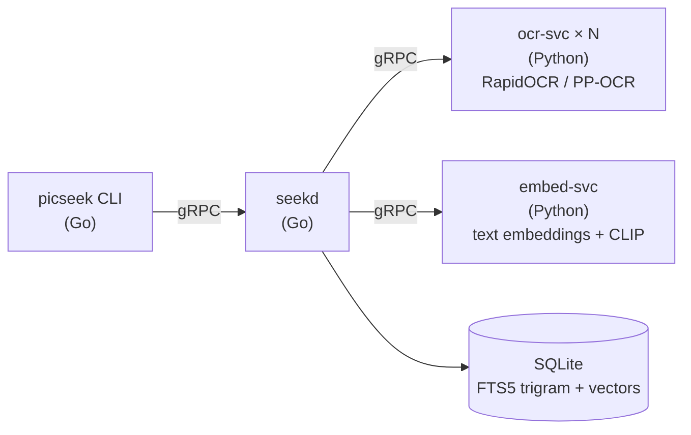

# picseek

```
$ picseek search boarding march
~/Pictures/Screenshots
├── [1] Screenshot from 2026-03-12 14-22-01.png
└── [3] Screenshot from 2026-03-02 09-41-17.png
~/Downloads
└── [2] scan_0042.png

3 matches in 2 folders · 4 ms
```

## How it works



- **seekd** watches folders, keeps a persistent job queue, and owns the index.
- **ocr-svc** reads the text in each image. **embed-svc** turns text and images into vectors.
- Search combines four layers, ranked in this order:
  1. exact text (partial words match)
  2. near matches (OCR misreads like `0`/`O`, words split by OCR)
  3. meaning (the words do not have to match)
  4. what the image shows

## Run from source

```
make sync     # Python dependencies
make build    # Go binaries into bin/
make run      # starts seekd, the OCR workers and the embedding service
```

In another terminal:

```
bin/picseek index ~/Pictures/Screenshots
bin/picseek search "boarding confirmation"
bin/picseek status
```

Models are downloaded on first use into `.models/`, and the index lives in `.data/`. Both are inside the repo and git-ignored.

## Search syntax

| Query                                     | Meaning                                                |
| ----------------------------------------- | ------------------------------------------------------ |
| `boarding march`                          | every word must appear                                 |
| `"exact phrase"`                          | phrase on one line                                     |
| `-word`                                   | exclude images containing the word                     |
| `folder:downloads`                        | folder path contains the text                          |
| `on:week`, `since:march`, `until:2026-08` | date filters                                           |
| `type:money`                              | money, travel, message, dev, security, document, chart |

Useful flags:

| Flag      | Effect                            |
| --------- | --------------------------------- |
| `-n 10`   | at most 10 results (default: all) |
| `--why`   | show which layer matched          |
| `--paths` | bare paths for piping             |
| `--json`  | machine-readable output           |

## Opening results

Every search remembers its results, so they can be opened by number with the default image viewer:

```
picseek search visa
picseek open 2
picseek open 1 3
```

In terminals that support links (GNOME Terminal, Kitty, iTerm2, the VS Code terminal), the file names in the results can also be clicked.

## Search quality

`make eval` generates a synthetic corpus of screenshots with labelled queries, runs an isolated instance against it, and reports recall@5, recall@10 and MRR for each search layer, how many off-topic queries return results, and type classification accuracy.

The latest report is in [`eval/results/synthetic.md`](eval/results/synthetic.md).

## Documentation

- [Architecture](docs/architecture.md)
