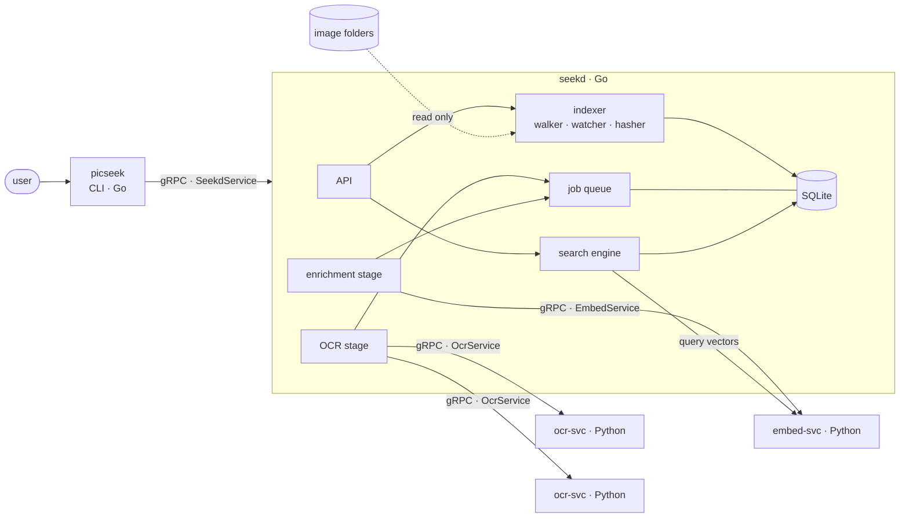
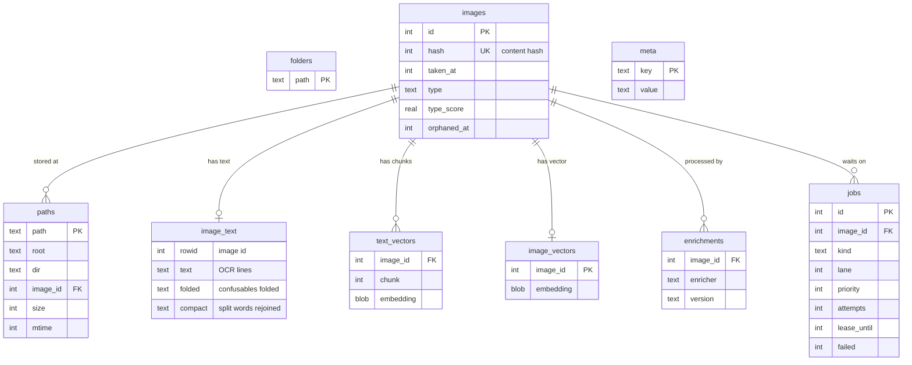
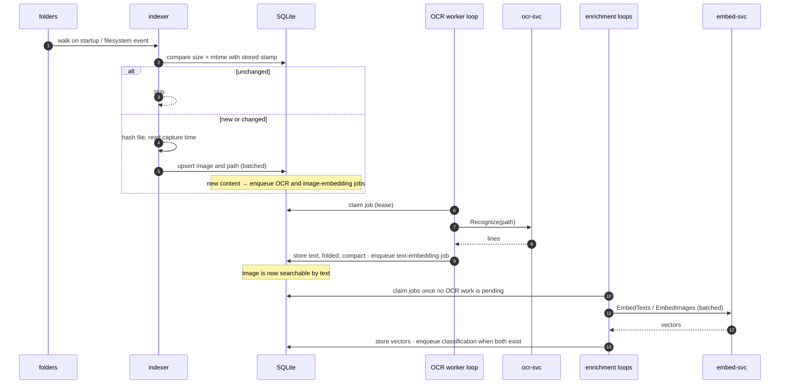
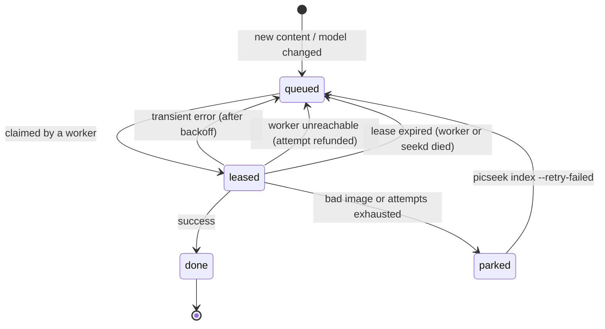
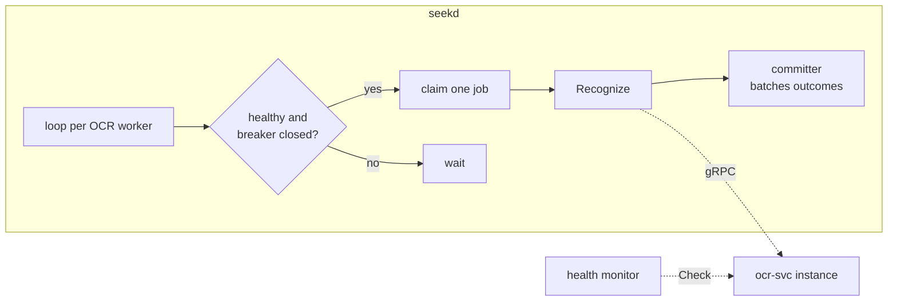
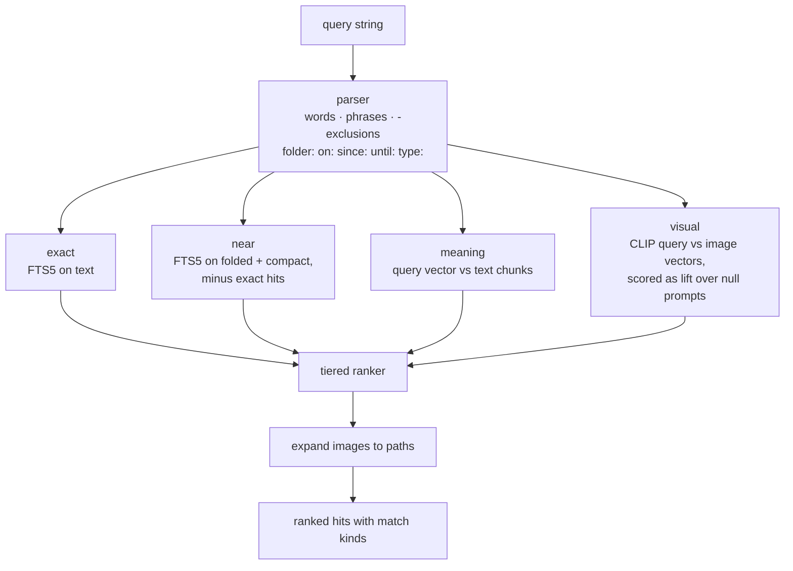

# Architecture

picseek is a set of local processes that index image files and answer search queries. Systems work (watching, scheduling, storage, search) is done in Go, model inference in Python, and the two talk over gRPC on unix sockets.

## System overview

| Process     | Language | Role                                                              | State                                    |
| ----------- | -------- | ----------------------------------------------------------------- | ---------------------------------------- |
| `seekd`     | Go       | Watches folders, schedules work, owns the index, answers searches | All persistent state                     |
| `ocr-svc`   | Python   | Reads text and line boxes from an image                           | None; several instances run side by side |
| `embed-svc` | Python   | Turns text and images into vectors                                | None                                     |
| `picseek`   | Go       | Command-line client of `seekd`                                    | None                                     |

Only `seekd` writes to the database. The Python services are pure functions of their input, so they can be restarted, replaced or scaled without coordination.

## Service contracts

All boundaries are defined in `proto/` and generated with `buf` for Go and Python. CI checks that the generated code is up to date, and pull requests are checked for breaking changes.

| Service        | Package            | Calls                                                                                          |
| -------------- | ------------------ | ---------------------------------------------------------------------------------------------- |
| `OcrService`   | `picseek.ocr.v1`   | `Recognize` (image → lines with boxes and confidence), `Info` (engine and version)             |
| `EmbedService` | `picseek.embed.v1` | `EmbedTexts`, `EmbedClipTexts`, `EmbedImages`, `Info`                                          |
| `SeekdService` | `picseek.seekd.v1` | `AddFolders`, `ForgetFolder`, `RetryFailed`, `Search`, `Status`, `WatchStatus` (server stream) |

Images are passed as an `ImageSource`: a file path, or the raw bytes when the service cannot see the file. Every service also implements the standard `grpc.health.v1.Health`.

Status codes carry meaning for the caller:

| Code from a service | Meaning                                                  | What `seekd` does                                                      |
| ------------------- | -------------------------------------------------------- | ---------------------------------------------------------------------- |
| `INVALID_ARGUMENT`  | The image itself is bad (unreadable, corrupt, too large) | Park the job; do not retry                                             |
| `NOT_FOUND`         | The file disappeared                                     | Drop that path and retry with another path to the same image           |
| `UNAVAILABLE`       | The worker is unreachable                                | Release the job without spending an attempt; mark the worker unhealthy |
| anything else       | Possibly transient                                       | Retry with jittered backoff, park after the attempt limit              |

## Storage

One SQLite database in WAL mode holds everything. `seekd` opens one write connection, so writes are serialised in the application, and a pool of read-only connections for queries. Schema changes are embedded migrations applied at startup.

- **Images are content-addressed.** An image's identity is a hash of its bytes, and a path is a pointer to an image. Renaming, moving or copying a file only touches `paths`; expensive work is never repeated for the same content.
- **`image_text`** is an FTS5 table with the trigram tokenizer, one document per image. It has three columns: the OCR text as read, a folded copy for OCR misreads, and a compact copy with split words rejoined.
- **Vectors** are stored as little-endian float32 blobs next to everything else, so text, vectors and job state change in the same transaction.
- **`enrichments`** records which version of each engine or model produced an image's data, so a model change reprocesses only what that model affects.
- **`meta`** records versions of derived data, such as the text normaliser that builds `folded` and `compact`, which is rebuilt at startup when it changes.

## Indexing

- **Discovery.** On startup every watched folder is walked; afterwards a filesystem watcher reports changes. New files are processed only after they stop changing, so half-written screenshots are never hashed.
- **Skip logic.** Size and modification time decide whether a file needs reading at all; the content hash decides whether its content is new. Only new content creates work.
- **Capture time.** Taken from EXIF when present, otherwise from a timestamp in the file name (as written by common screenshot tools), otherwise from the modification time.
- **Two phases.** OCR comes first so text search works as early as possible. Embeddings and classification run afterwards and yield whenever OCR work is waiting.
- **Two lanes.** Files seen by the watcher go into a live lane that is served before the backfill of existing files, which is processed newest first.
- **Garbage collection.** When the last path to an image disappears the image is marked orphaned but kept, so moving a file out of a folder and back costs nothing. Orphans are deleted after a grace period.

## Job queue

The queue is a table in the same database. A worker claims jobs with a single `UPDATE … RETURNING` that sets a lease and counts the attempt.

- Results are keyed by content hash, so running a job twice is harmless. Leases give at-least-once processing and idempotency makes the outcome effectively once.
- At startup any lease still held belongs to a dead process (only one `seekd` runs per socket), so it is released immediately.
- Job kinds: `ocr`, `embed_text`, `embed_image`, `classify`.
- At startup `seekd` asks each service for its engine and model versions and enqueues work for images that are missing an enrichment or were produced by an older version.

## Workers

- **Pull-based dispatch.** Each OCR worker has its own loop that claims a job only when the worker is idle. Load balancing follows from that: a slow or dead worker simply stops pulling.
- **Health and circuit breaking.** A monitor runs gRPC health checks; a per-worker circuit breaker opens after repeated failures and lets a single probe through after a cool-down. A worker is used only when both agree.
- **Deadlines.** Every call has a deadline. In-flight calls are allowed to finish on shutdown; unfinished jobs return to the queue through their leases.
- **Batched commits.** A single committer writes outcomes. It writes immediately when nothing else is waiting and batches under load, which keeps latency low when idle and throughput high during a backfill.
- **Inside a Python service** one inference runs at a time and the model uses several threads; parallelism comes from running several processes. Spare RPC threads keep health checks answering during long inferences. Models load on first use and unload after an idle period.

## Reading text

- The default engine is RapidOCR with PaddleOCR models on ONNX Runtime; Tesseract is available behind the same interface.
- Large images are decoded at reduced size and capped before recognition; boxes are mapped back to original coordinates.

## Search

- **Exact.** Every word must appear somewhere in the image's text (trigram matching, so partial words match), phrases must appear on one line, and words too short for trigrams are matched as whole words afterwards.
- **Near.** Query and stored text are folded the same way: characters OCR confuses are mapped together, and repeated characters collapse. Fragments that OCR split apart are rejoined, so `pay ment` matches `payment` and `num ber` matches `number`, but a fragment that is a real word on its own, such as `to` or `the`, is never glued to its neighbour.
- **Meaning.** OCR text is split into chunks before embedding, because the text model reads a limited number of tokens; an image scores by its best chunk.
- **Visual.** Raw CLIP similarity is similar for almost any query against any screenshot, so an image's score is how much more it matches the query than a set of generic prompts.
- **Cut-offs.** Meaning and visual hits must clear a minimum score and stay within a margin of the best hit (`search.semantic_*`, `search.visual_*`), so off-topic queries return nothing instead of the whole collection.
- **Ranking.** Results come in tiers: exact and filter matches, then near matches, then meaning and visual together, fused with reciprocal rank fusion. An image found by several layers keeps its best tier and reports every layer that found it (`--why`).
- **Filters** are applied in SQL before any scoring. `type:` uses the label and probability stored by the classifier, with the threshold applied at query time (`search.type_min`).
- **Layers** can be restricted per request, which is how the evaluation measures what each layer adds.
- If `embed-svc` is unavailable, meaning and visual return nothing and text search continues.

## Classification

Each image gets a type (money, travel, message, dev, security, document, chart) without any training, or no type when none fits. Each label has image prompts and text descriptions, embedded once. An image is compared with them using vectors it already has: its CLIP vector against the image prompts, its text chunks against the descriptions. The two modalities each give a probability per label and are averaged. A set of prompts for screens that fit no type (settings, dialogs, forms) competes too; when it wins, the image gets no type. The best label and its probability are stored. The classifier's version is a hash of its prompts and models, so changing a prompt reclassifies every image from stored vectors without calling a model.

## Process lifecycle

- **Startup.** `seekd` refuses to start if another instance answers on its socket, applies migrations, rebuilds derived text if the normaliser changed, releases stale leases, then starts the watcher, the initial scans, the worker loops and the API.
- **Shutdown.** On SIGTERM or SIGINT each process stops accepting work, lets in-flight calls finish within a deadline, and removes its socket. Python services switch their health status to not serving first.
- **Sockets** live in a private directory under `$XDG_RUNTIME_DIR` (`services.socket_dir`). Socket path length is checked up front, because Linux limits it.

## Configuration and files

| What    | Development (`make run`)                      | Default otherwise                 |
| ------- | --------------------------------------------- | --------------------------------- |
| Config  | `~/.config/picseek/config.toml` or `--config` | `~/.config/picseek/config.toml`   |
| Index   | `.data/picseek/index.db`                      | `~/.local/share/picseek/index.db` |
| Models  | `.models/`                                    | `~/.cache/picseek/models`         |
| Sockets | `$XDG_RUNTIME_DIR/picseek/`                   | `$XDG_RUNTIME_DIR/picseek/`       |

Image folders are only ever read.

## Evaluation

`make eval` renders a synthetic corpus of screenshots in many layouts with labelled queries, starts an isolated instance with its own sockets and data directory, records raw scores for calibration, then reports per-layer recall and MRR, off-topic results and classification accuracy. The report is written to `eval/results/synthetic.md`.
